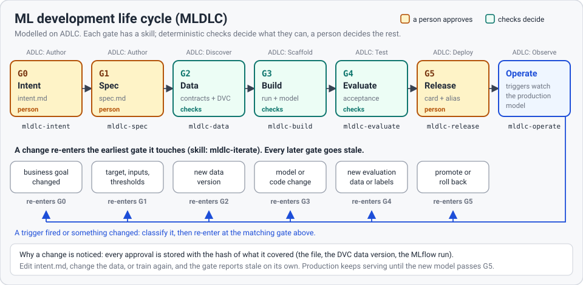

<p align="center">
  <picture>
    <source media="(prefers-color-scheme: dark)" srcset="docs/assets/brand/majlis-lockup-reversed.svg">
    
  </picture>
</p>

# mldlc-kit: a gated ML life cycle for new projects

`mldlc-kit` takes an ML model from `intent.md` and `spec.md` to production, and back through the right gate
whenever something changes. It is modelled on ADLC (author, discover, scaffold, deploy, test, observe) and has
two parts that work together:

- **Skills for Claude Code**, one per stage gate: intent, spec, data, build, evaluate, release, operate and
  iterate. They hold the procedure and the quality bar for each stage.
- **The `mldlc` command**, which decides the gates. It checks the documents, reads the evidence from MLflow,
  keeps an approval ledger, and promotes or rolls back a model. A skill cannot declare a gate passed; the
  command has to say so, and the human gates (intent, spec, release) need a person.



Why it exists: a model is not done when it trains. Someone has to say what it is for, what counts as good
enough *before* it exists, prove the data and the code are what they claim, and notice when the world moves.
Each approval is stored with a hash of what it covered, so editing the intent, changing the data or training
again makes the affected gates go stale on their own.

## Quickstart

You need Python 3.10+, [uv](https://docs.astral.sh/uv/) and an MLflow tracking store (a SQLite file is enough:
`export MLFLOW_TRACKING_URI=sqlite:///mlflow.db`; with no setting, MLflow 3 uses a local SQLite file).
Claude Code is optional but recommended: the skills are where the guidance lives.

```bash
# 1. the command
uv tool install git+https://github.com/majlisofai/mldlc-kit.git

# 2. the skills, either as a Claude Code plugin ...
claude plugin marketplace add majlisofai/mldlc-kit
claude plugin install mldlc@mldlc-kit
#    ... or copied into the project (no plugin needed)
mldlc init --hooks --skills

# 3. start a project (in your project's folder)
mldlc init --hooks
mldlc status                                         # the gates, and the next stage
```

In Claude Code, `/mldlc` shows the gate table and routes you to the right stage skill. Without Claude Code,
follow `mldlc status`, fill the two documents, and run `mldlc check <gate>`.

### Connect your training code (about ten lines)

The gates read a handful of MLflow run tags and metrics. Two helpers write them:

```python
import mlflow, mldlc
project = mldlc.Project.load()                          # finds mldlc.yaml

# in your data checks: record the outcome against the data version
mldlc.record_validation(project, passed=not problems, report={"problems": problems})

# in your training script
mlflow.set_experiment(project.training_experiment)
with mlflow.start_run():
    mlflow.set_tags(mldlc.lineage_tags(project))        # data version, git commit, dirty flag
    mlflow.log_metrics({"accuracy": acc, "uplift_vs_baseline": acc - baseline_acc})
    mlflow.sklearn.log_model(model, name="model", registered_model_name=project.model_name)
```

Then `mldlc.yaml` says how the project is named and what identifies its data, and an optional
`mldlc_hooks.py` ties the spec to your code (`model_inputs()`, `serving_columns()`, `smoke_payload()`). See
[docs/evidence-contract.md](docs/evidence-contract.md) for the full list.

## The commands

| Command | What it does |
|---|---|
| `mldlc init [--hooks] [--skills]` | start a project: `mldlc.yaml`, `lifecycle/intent.md`, `lifecycle/spec.md` |
| `mldlc status [--require G1,G2] [--json]` | the gates; with `--require`, exit 1 unless they are valid (for CI) |
| `mldlc check G0..G5` | run a gate's checks and change nothing |
| `mldlc approve G0..G4 --by <name>` | record a passed gate. G0 and G1 need a person's name; G2 to G4 use `--by gate-check` |
| `mldlc card [version]` | create the model card with the facts filled in from MLflow |
| `mldlc promote --by <name>` | G5: set the production alias, only after every gate and a smoke test |
| `mldlc rollback --to N --by <name> --reason ...` | move the alias back to a version that passed G5 |
| `mldlc triggers` | evaluate the spec's monitoring triggers; say where to re-enter |
| `mldlc reentry <kind>` | which gate a kind of change re-enters |
| `mldlc info` | the project's configuration and commands |
| `mldlc skills install` | copy the skills into `.claude/skills` |

Use `mldlc -C <folder> ...` for a project in another folder (for example in a monorepo).

## The gates

| Gate | Stage | Required to pass | Decided by |
|---|---|---|---|
| G0 | Intent | every section of `intent.md` filled, an owner, no `TODO` | a person |
| G1 | Spec | complete `spec.md`; inputs equal the code; numeric acceptance criteria that require beating the baseline; valid triggers | a person |
| G2 | Data | the latest validation passed on the *current* data version | checks |
| G3 | Build | a training run on that data, from clean committed code, with a registered model | checks |
| G4 | Evaluate | every acceptance threshold in the spec met by that run | checks |
| G5 | Release | G0 to G4 valid, a model card stating the facts, a smoke test, and a person's approval | a person |

Read [docs/lifecycle.md](docs/lifecycle.md) for how a change re-enters, and
[docs/adopting.md](docs/adopting.md) for using it in an existing repository, a monorepo and CI.

## Try it: the worked example

`examples/toy` is a customer-churn project that uses the kit the way a new project would, with a real intent
and spec. The test `tests/test_e2e.py` takes it from intent to production against a real MLflow store, changes
the data, iterates to a second release and rolls back.

```bash
uv sync --extra dev
uv run pytest -q          # unit tests, and the end-to-end run (about 15 seconds)
```

## What it does not do

- **It cannot verify who a person is.** Human gates refuse `--by gate-check`, and the skills forbid an agent
  from approving them, but the name is a string. The ledger (`lifecycle/gates.yaml`) is meant to live in git
  and be reviewed like code.
- **Operate is thin.** Triggers read metrics from the latest training run. Drift in value distributions and
  live prediction quality are not part of the kit, and a validation schema cannot catch every unit change.
- **Production means a registry alias**, not a deployed service. The smoke test loads the model and scores a
  payload you provide.
- **It does not choose your validation or training tools.** It asks for the evidence they leave in MLflow.

## Development

```bash
uv sync --extra dev && uv run pytest -q
claude plugin validate .          # checks the plugin and marketplace manifests
```

The skills live in `skills/` (the plugin layout) and are bundled into the wheel, so `mldlc skills install`
works from a plain install. `tests/test_skills.py` checks that every skill has valid YAML frontmatter, names
real commands and gates, and stays free of anything specific to one project.

## License

[MIT](LICENSE), copyright The Majlis of AI. Issues and pull requests are welcome.

---

<p align="center">
  <picture>
    <source media="(prefers-color-scheme: dark)" srcset="docs/assets/brand/majlis-symbol-reversed.svg">
    
  </picture>
  <br>
  <sub>Counsel for AI in regulated institutions.</sub>
</p>
