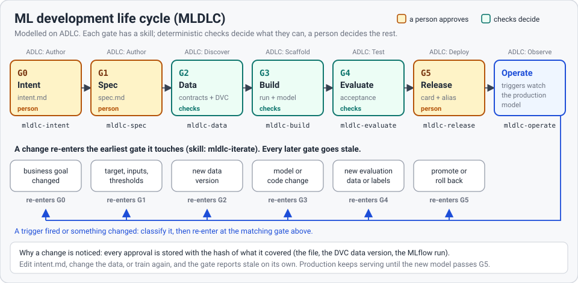

<picture>
  <source media="(prefers-color-scheme: dark)" srcset="assets/brand/majlis-symbol-reversed.svg">
  
</picture>

# The life cycle

A model's life runs from an idea to production and back again whenever something changes. `mldlc` models it
on ADLC (author, discover, scaffold, deploy, test, observe) and makes explicit the two artifacts ADLC leaves
implicit: `intent.md` and `spec.md`.

## Who does what

| Part | Role |
|---|---|
| **Skills** | The procedure and the judgement for each stage: what to ask, what to write, what quality bar to apply. They guide an agent or a person. |
| **`mldlc`** | The deterministic gates: document checks, evidence from MLflow, the approval ledger, promotion and rollback. A skill cannot declare a gate passed. |
| **People** | Approve G0 (intent), G1 (spec) and G5 (release), and set the acceptance thresholds. |

## The stages

| Gate | Stage | Artifact | Skill |
|---|---|---|---|
| G0 | Intent | `lifecycle/intent.md` | `mldlc-intent` |
| G1 | Spec | `lifecycle/spec.md` with `model-inputs`, `acceptance` and `triggers` blocks | `mldlc-spec` |
| G2 | Data | a data version and a validation run recorded against it | `mldlc-data` |
| G3 | Build | a training run and a registered model, from committed code | `mldlc-build` |
| G4 | Evaluate | the run's metrics against the spec's thresholds | `mldlc-evaluate` |
| G5 | Release | `lifecycle/releases/v<N>.md` and the production alias | `mldlc-release` |
| - | Operate | the spec's triggers | `mldlc-operate` |
| - | Iterate | `lifecycle/changes/*.md` | `mldlc-iterate` |

## How a change is noticed

Every approval is stored in `lifecycle/gates.yaml` with the evidence it covered: the hash of `intent.md` and
`spec.md`, the data version, the MLflow run id, the production version. If any of that changes, the gate
reports `stale` and so does every gate after it. Nothing has to remember to invalidate it.

| A change to... | re-enters | because |
|---|---|---|
| the business goal, users, constraints | G0 | the intent is what the spec was written for |
| target, label timing, inputs, thresholds, triggers | G1 | the contract changed |
| a new data version or source | G2 | the validation must be redone on it |
| the model, features or code | G3 | a new candidate |
| new evaluation data, such as final labels | G4 | the same model, judged again |
| promote or roll back | G5 | only the release changes |

`mldlc reentry <kind>` prints the gate and the gates to pass again. The production model keeps serving until
its replacement passes G5, so an iteration never leaves a gap, and a rollback only returns to a version that
was released through G5.

## What is deliberately left to people

- The intent, the thresholds and the release decision. The tool refuses `--by gate-check` for them, and the
  skills tell an agent to ask. The tool cannot verify identity, so review `gates.yaml` like code.
- Choosing validation and training tools. The kit asks only for the evidence in
  [the evidence contract](evidence-contract.md).
- Drift and live-quality monitoring. Triggers cover what the latest training run's metrics can show.
